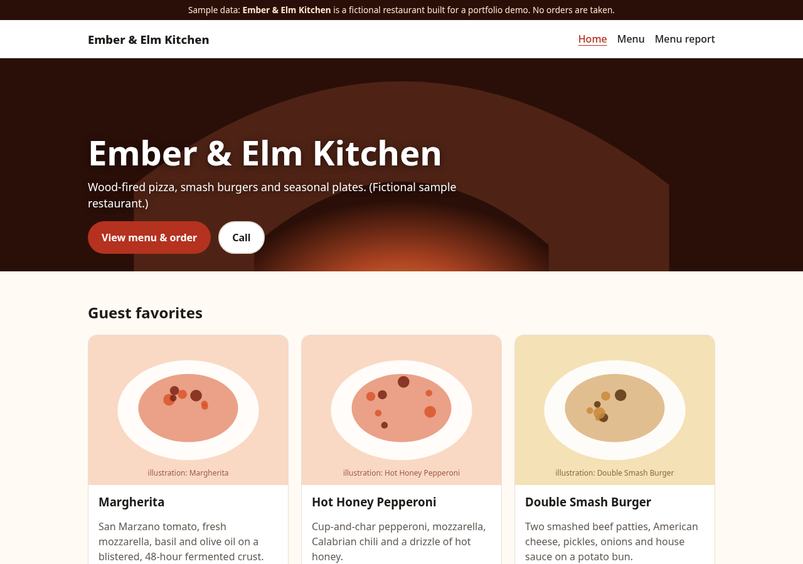

# restaurant-site-poc

[](https://github.com/anothermoth/restaurant-site-poc/actions/workflows/ci.yml)

A fast, static restaurant website generated from menu JSON (Astro + one React island for the cart), plus a **menu-quality checker**: deterministic rules, safe auto-fixes, and an optional LLM pass that suggests better item copy. TypeScript end to end, in an npm-workspaces monorepo.

> **Sample data.** "Ember & Elm Kitchen" is a fictional restaurant. The address, phone and menu are made up, item "photos" are generated SVG illustrations, and checkout is disabled. The sample menu has problems seeded on purpose so the checker has something to find.


| Home | Modifier picker (React island) | Cart |
|---|---|---|
|  |  |  |

## Why this exists

I built this to show the kind of work Owner.com's restaurant-website team does, at small scale:

- **Fast restaurant sites.** Owner's [Project Speed](https://building.owner.com/project-speed) post describes replacing their Next.js rendering stack with Astro on Cloudflare: markup by default, the ordering flow in a single React island, and cached HTML at the edge. They report menu-page LCP going from 5.4s to 0.7s at p75 and more than 4% higher per-restaurant revenue. This repo uses the same shape: static markup for everything and one hydrated island for the cart.
- **Menu quality at scale.** Owner describes automated systems that find and fix quality problems across roughly 10,000 merchant-written menus, with owners approving the changes an agent proposes. The checker here is a small version of that loop: rules detect problems, only provably safe fixes are applied automatically, and everything else (prices, duplicates, allergen tags, AI-written copy) is held for a person to approve.

## What's in it

```
packages/
  menu-schema/    zod schema + types: restaurant, categories, items, modifier groups/options,
                  prices (integer cents), photos, dietary/allergen tags; priceCart()
  menu-checker/   rules, report + score, safe auto-fix, optional LLM pass, `check-menu` CLI
apps/
  site/           Astro static site: / (home), /menu (menu + cart island), /admin/report
data/
  sample-restaurant.menu.json   fictional sample menu (with seeded problems)
  menu-report.llm.json          saved report from one real LLM run (see below)
scripts/          placeholder-art generator, Lighthouse runner
```

### 1. Menu schema (`@restaurant-site-poc/menu-schema`)

- Zod schema for the whole menu. Money is **integer cents** everywhere; float prices fail validation.
- Modifier groups live at the menu level and items reference them by id, so "Size" or "Add-ons" can be shared. Cross-references are validated (`superRefine`): unknown group ids and duplicate item ids are rejected.
- `priceCart(menu, lines)` prices a cart from ids and quantities only. It enforces min/max selections per group and rejects unknown items, options and bad quantities, so a tampered client payload can't change a total. It lives in a zod-free module (`menu-schema/pricing`) so the browser bundle stays small.

### 2. Site generator (`apps/site`)

- **Home**: hero, featured items, hours, address. **Menu**: sections with sticky category nav, prices, dietary badges and allergen notes, "Add" buttons. **Admin report**: the checker's findings (marked `noindex`).
- **One React island** (`Cart.tsx`, `client:idle`). The menu itself is plain HTML; the island attaches one delegated click listener for `[data-add-item]` buttons, opens a modifier picker for items with modifier groups, keeps the cart in `localStorage`, and prices it with the same `priceCart()`.
- **SEO**: per-page title/description, canonical URL, Open Graph tags, `robots.txt`, and **JSON-LD**: `Restaurant` (address, hours, cuisine) on every page, with a full `Menu` → `MenuSection` → `MenuItem` → `Offer` tree (plus `suitableForDiet`) on `/menu`. JSON-LD is escaped so menu text can't break out of the script tag.
- **Build-time publish pipeline**: validate with zod → run deterministic checks → apply safe auto-fixes → render. So "GARLIC KNOTS" ships as "Garlic Knots", but the $185.00 Truffle Pie stays on the page and gets flagged for the owner, because changing a price automatically isn't safe.

### 3. Menu checker (`@restaurant-site-poc/menu-checker` + `check-menu` CLI)

Deterministic rules:

| Rule | Severity | Auto-fix? |
|---|---|---|
| `price-outlier`: price ≥4x or ≤¼ of the category median; suggests the likely decimal slip ($185.00 → $18.50) | error | No: prices need a person |
| `empty-modifier-group`: a group with no options (an error if it's required and attached, because guests can't check out) | error / warning | Yes: remove the group and detach it |
| `duplicate-item`: same name after normalizing case, punctuation and `&` | warning | No |
| `missing-description`: empty (warning) or under 25 characters (info) | warning / info | No (the LLM can suggest copy) |
| `missing-photo` | warning | No |
| `missing-dietary-tags`: no tags at all, with keyword hints ("contains-dairy, contains-gluten, vegetarian?") | warning | **Never**: allergen claims must come from the kitchen |
| `inconsistent-naming`: ALL CAPS, all lowercase, stray whitespace | info | Yes: Title Case rename |
| `unused-modifier-group` | info | No |

The report has counts by severity, an at-a-glance 0-100 score, and every finding with a suggested action. `applySafeFixes()` returns a new menu (the input isn't mutated) and re-validates it with zod, so a fix can never produce an invalid menu.

**Optional LLM pass** (`--llm`): sends only the items the rules flagged for weak copy or missing tags to any **OpenAI-compatible** `/chat/completions` endpoint, asks for JSON, and validates the response with zod. Invalid JSON, schema failures and HTTP errors raise clear errors; suggestions for item ids that weren't sent are dropped. Without `OPENAI_API_KEY` the pass is **skipped cleanly** and no request is made. LLM suggestions are always `info` and never auto-applied.

I ran the LLM pass once against xAI's OpenAI-compatible API (`grok-4.20-0309-non-reasoning`) and committed the output to `data/menu-report.llm.json`; `/admin/report` shows it. It's a good illustration of why AI copy goes through approval: the model's rewrite for "Wood-Fired Wings" offered "classic buffalo or smoky BBQ sauce" and the chicken sandwich got a "brioche" bun. Neither is in the source menu.

```
$ npm run check-menu -- data/sample-restaurant.menu.json --fail-on none
Ember & Elm Kitchen (sample data): 17 items, score 51/100
1 errors, 9 warnings, 3 info, 4 auto-fixable

ERROR   price-outlier          "Truffle Pie" is $185.00, 10.0x above the Wood-Fired Pizza median.
        -> Looks like a decimal slip: did you mean $18.50? Category median is $18.50.
WARNING empty-modifier-group   Modifier group "Dressing" has no options but is attached to "Caesar Salad". [auto-fix]
...
```

CLI options: `--json <file>` (full report), `--fix <file>` (write the auto-fixed menu), `--llm`, `--fail-on error|warning|info|none` (exit code for CI gating; default `error`).

## Performance (measured)

Lighthouse 13.6.0 on Chrome 156 (headless), run locally against the production build served by `astro preview` on localhost. Mobile uses Lighthouse's default simulated throttling (slow 4G, 4x CPU slowdown). Measured on Nov 24, 2026. Raw summary: [`docs/lighthouse-summary.json`](docs/lighthouse-summary.json).

| Page | Mode | Performance | Accessibility | Best Practices | SEO | LCP | FCP | TBT | CLS | Transfer |
|---|---|---|---|---|---|---|---|---|---|---|
| `/` | mobile | 100 | 100 | 100 | 100 | 0.9 s | 0.6 s | 20 ms | 0 | 9 KiB |
| `/` | desktop | 100 | 100 | 100 | 100 | 0.2 s | 0.2 s | 0 ms | 0 | 9 KiB |
| `/menu` | mobile | 100 | 100 | 100 | 100 | 0.7 s | 0.7 s | 0 ms | 0 | 96 KiB |
| `/menu` | desktop | 100 | 100 | 100 | 100 | 0.2 s | 0.2 s | 0 ms | 0 | 96 KiB |

Caveats: this is a lab test on localhost, with no CDN and no network latency, a small sample menu, SVG placeholder images, and none of the third-party analytics tags a real restaurant site carries. Owner's 5.4s → 0.7s numbers are p75 field data across real traffic; these are not comparable to that, they only show the architecture starts fast. The home page ships no JavaScript. On `/menu`, the cart island is about 8 KB of app code plus React's runtime, loaded at idle.

Reproduce: `npm run build && npm run lighthouse` (needs Chrome installed).

## Run it

Requires Node 22+ (CI uses Node 24 from `.nvmrc`).

```bash
npm ci
npm run dev            # http://localhost:4321  (/, /menu, /admin/report)
npm test               # Vitest: schema, pricing, rules, auto-fix, LLM pass (mocked), JSON-LD, cart reducer, Cart island
npm run typecheck      # tsc for packages, astro check for the site
npm run lint
npm run build          # static site in apps/site/dist
npm run check-menu -- data/sample-restaurant.menu.json --json report.json --fix fixed.json

# optional LLM pass; any OpenAI-compatible endpoint works (see .env.example)
OPENAI_API_KEY=... OPENAI_BASE_URL=https://api.openai.com/v1 OPENAI_MODEL=gpt-4o-mini \
  npm run check-menu -- data/sample-restaurant.menu.json --llm --json data/menu-report.llm.json
```

CI (GitHub Actions) runs install → typecheck → lint → test → `check-menu` (deterministic only) → build, and uploads the built site as an artifact. CI never calls an LLM. Nothing is deployed.

## Design decisions and trade-offs

- **Astro over Next.js static export.** I had an earlier Next.js 16 prototype of an Owner-style site (a private `owner-clone` repo), but it was a mobile-first page over hardcoded data, so it didn't give much of a head start. Astro's model (markup by default, opt-in hydration per island) is exactly what this page type needs. It's also what Owner moved to, so the comparison is direct. Next.js static export would ship the React runtime and hydrate the whole page by default. I kept the earlier prototype's single-column, mobile-first card layout.
- **One island, delegated events.** I could have made every "Add" button its own island, but that would mean many hydration roots. Instead the menu stays static HTML, and one island owns all cart and modifier state, which mirrors Owner's "ordering flow in a single React island".
- **Island props are trimmed.** The cart island only gets ids, names, prices and modifier groups (no descriptions or photos), so the serialized props stay small. Zod stays out of the browser bundle: the island imports the zod-free `pricing` module. That took the island from about 94 KB to about 8 KB.
- **Integer cents and server-shaped pricing.** `priceCart()` is the same function a server checkout would call. The browser only ever sends ids and quantities.
- **What's safe to auto-fix?** Only things that can't mislead a guest or cost the restaurant money: casing and whitespace, and removing a modifier group that has no options. Prices, duplicates, dietary and allergen tags, and AI copy all need approval. This matches how Owner Agent asks owners to approve proposed menu changes.
- **Price outliers use a median ratio, not standard deviation.** Categories are small (3-10 items), and one typo like 18500 for 1850 would inflate a mean/SD threshold enough to hide itself. Categories with fewer than 3 items are skipped.
- **LLM output is untrusted input.** It's JSON mode plus zod validation, a whitelist of item ids, no auto-apply, and the prompt tells the model not to invent allergens or prices. As the committed sample shows, models still embellish, so the approval step matters.
- **No database or backend.** The site is generated at build time from a JSON file, standing in for Owner's backend. A real version would rebuild or revalidate the affected pages when the menu changes (as Owner's Apollo does), add a server checkout, and run the checker on every menu save.

### Not built (yet)

A server-side checkout endpoint; deploying to Cloudflare Pages or Workers with edge caching; photo-quality checks (resolution, blur); per-location menus and hours exceptions; an approve/reject UI for findings; running the checker across many menus in batch.

## How this was built

I built this with AI-assisted pair programming and reviewed it myself: I directed the design and reviewed the code, tests and output, and an AI coding assistant did much of the typing. All performance numbers above were measured, not estimated.

## License

MIT
