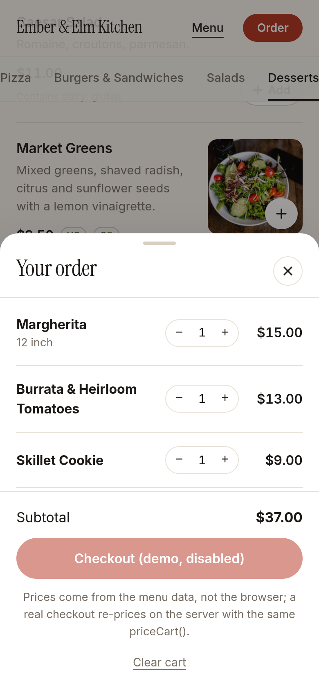
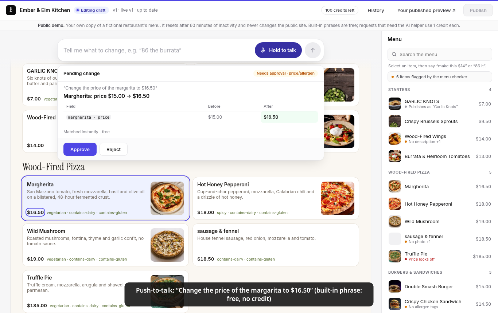
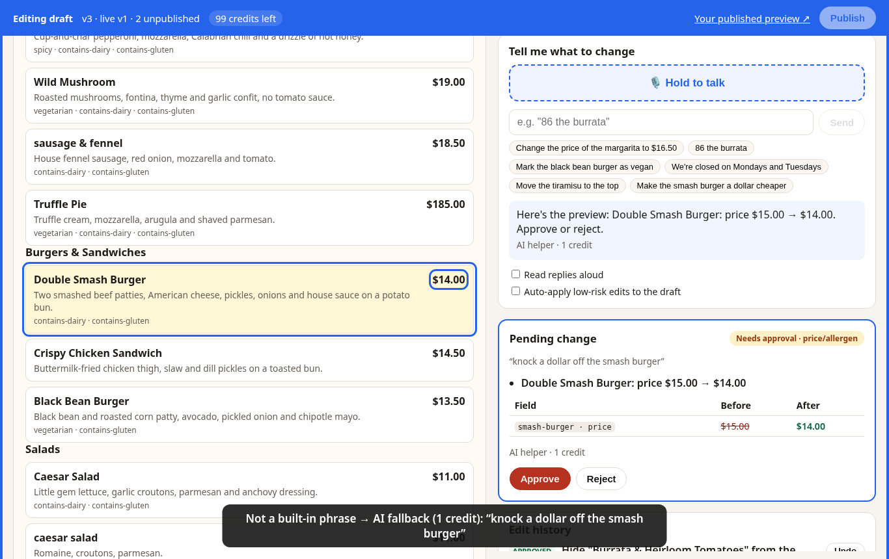
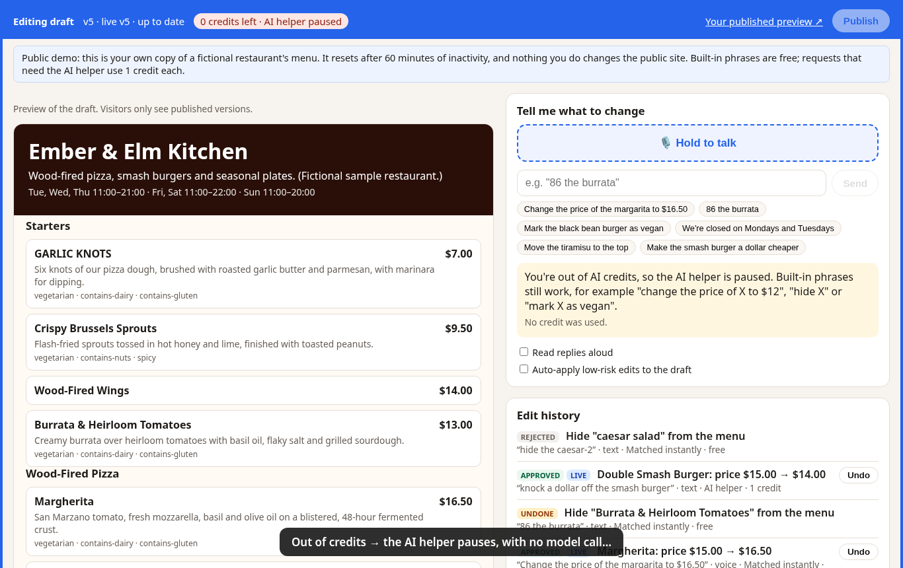
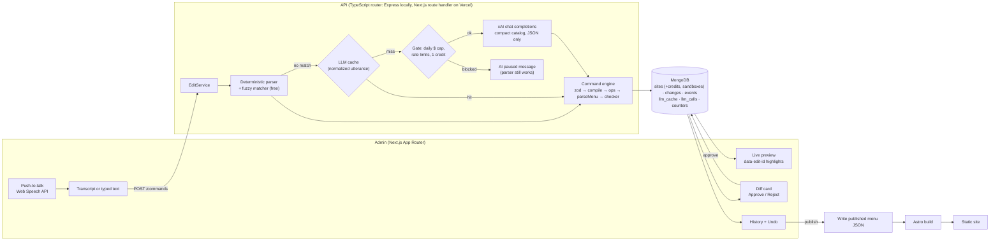

# restaurant-site-poc

[](https://github.com/anothermoth/restaurant-site-poc/actions/workflows/ci.yml)

A fast, static restaurant website generated from menu JSON (Astro + one React island for the cart), a **menu-quality checker** (deterministic rules, safe auto-fixes, an optional LLM pass for item copy), and a **voice-driven, owner-approved site editor**: say or type "86 the burrata" or "raise the margherita by a dollar", review the diff, approve, publish. TypeScript end to end, in an npm-workspaces monorepo: Astro, React, Next.js App Router, Node/Express, MongoDB.

**Live demo**
- **Editor:** https://restaurant-site-poc-editor.vercel.app (Vercel + MongoDB Atlas M0, public-demo mode). You get your own sandbox copy of the menu with 25 AI credits; built-in phrases are free.
- **Restaurant site:** https://restaurant-site-poc.pages.dev (Cloudflare Pages, static Astro).

Deploy steps: [docs/deploy.md](docs/deploy.md).


*Demo, 45 s ([MP4](docs/demo.mp4)), recorded in public-demo mode: a spoken price change → approve → click the burrata in the menu panel and type "86 it" → a request the parser doesn't know, handled by the AI fallback for 1 credit → a clarifying question for an ambiguous name → reject → undo → publish to the visitor's private preview → out of credits: the AI helper pauses, and built-in phrases still work. The speech in the recording is simulated: the script feeds fixed transcripts to the browser's speech-recognition API so the run is repeatable. Everything after the transcript is the real stack.*

> **Sample data.** "Ember & Elm Kitchen" is a fictional restaurant. The address, phone and menu are made up, and checkout is disabled. The food photos are real, free-licensed photography from Pexels, used for illustration (credits and license in [CREDITS.md](CREDITS.md); the photos are not covered by the MIT license). The sample menu has problems seeded on purpose so the checker has something to find. One of them is a second "caesar salad" (`caesar-2`): it stays in the data so the checker flags the duplicate and the editor can ask "which one?", but it ships hidden, so guests see one Caesar Salad.


| Home | Modifier picker (React island) | Cart |
|---|---|---|
|  |  |  |

Before/after screenshots of the Nov 2026 visual redesign (desktop and mobile, site and editor) are in [`docs/redesign/`](docs/redesign/).

## Why this exists

I built this to show the kind of work Owner.com's restaurant-website team does, at small scale:

- **Fast restaurant sites.** Owner's [Project Speed](https://building.owner.com/project-speed) post describes replacing their Next.js rendering stack with Astro on Cloudflare: markup by default, the ordering flow in a single React island, and cached HTML at the edge. They report menu-page LCP going from 5.4s to 0.7s at p75 and more than 4% higher per-restaurant revenue. This repo uses the same shape: static markup for everything and one hydrated island for the cart.
- **Menu quality at scale.** Owner describes automated systems that find and fix quality problems across roughly 10,000 merchant-written menus, with owners approving the changes an agent proposes. The checker here is a small version of that loop: rules detect problems, only provably safe fixes are applied automatically, and everything else (prices, duplicates, allergen tags, AI-written copy) is held for a person to approve.

## What's in it

```
packages/
  menu-schema/    zod schema + types: restaurant, categories, items, modifier groups/options,
                  prices (integer cents), photos, dietary/allergen tags; priceCart()
  menu-checker/   rules, report + score, safe auto-fix, optional LLM pass, `check-menu` CLI
  command-engine/ editor commands (zod), deterministic parser + fuzzy matcher, LLM fallback,
                  compile → reversible ops, undo
apps/
  site/           Astro static site: / (home), /menu (menu + cart island), /admin/report
  api/            MongoDB service + framework-free router: drafts, pending changes, approve/reject,
                  undo, publish, credits, demo sandboxes; runs under Express locally
  admin/          Next.js App Router editor: live preview, push-to-talk, diff, history, credits;
                  serves the API from a route handler (Vercel); /published, /dev (margin)
data/
  sample-restaurant.menu.json   fictional sample menu (with seeded problems)
  menu-report.llm.json          saved report from one real LLM run (see below)
docs/
  token-costs.json              measured parser vs. LLM token usage (see below)
  photos/                       self-hosted Pexels photos (+ sources.json); see CREDITS.md
scripts/          Lighthouse runner, screenshots, editor photo thumbnails, token measurement, demo recorder
```

### 1. Menu schema (`@restaurant-site-poc/menu-schema`)

- Zod schema for the whole menu. Money is **integer cents** everywhere; float prices fail validation.
- Modifier groups live at the menu level and items reference them by id, so "Size" or "Add-ons" can be shared. Cross-references are validated (`superRefine`): unknown group ids and duplicate item ids are rejected.
- `priceCart(menu, lines)` prices a cart from ids and quantities only. It enforces min/max selections per group and rejects unknown items, options and bad quantities, so a tampered client payload can't change a total. It lives in a zod-free module (`menu-schema/pricing`) so the browser bundle stays small.

### 2. Site generator (`apps/site`)

- **Design**: a full-bleed photo hero, Instrument Serif for display type with Inter for text (both self-hosted, latin subset, preloaded), a warm restrained palette, a classic menu list (serif dish names, dotted leaders to menu-style prices, dietary notes in plain words like "Vegetarian · Contains dairy & gluten") with one feature photo per section that alternates sides on desktop and sits above the list on phones, a sticky order button (a bottom bar on mobile) and a modifier sheet that slides up from the bottom on phones. Photos go through Astro's `<Picture>`: AVIF and WebP at several widths with `srcset`/`sizes`, explicit dimensions, lazy below the fold and `fetchpriority="high"` on the hero. Because photos are per section rather than per dish, dishes without a photo or description leave no holes. The pre-v3 card layout is tagged [`site-v2`](../../tree/site-v2); before and after screenshots (desktop and mobile, home, menu and the editor preview, which uses the same design) are in [`docs/redesign-v3/`](docs/redesign-v3/).
- **Home**: hero, featured items, hours, address. **Menu**: sections with sticky category nav, prices, dietary badges and allergen notes, "Add" buttons. **Admin report**: the checker's findings (marked `noindex`).
- **One React island** (`Cart.tsx`, `client:idle`). The menu itself is plain HTML; the island attaches one delegated click listener for `[data-add-item]` buttons, opens a modifier picker for items with modifier groups, keeps the cart in `localStorage`, and prices it with the same `priceCart()`.
- **SEO**: per-page title/description, canonical URL, Open Graph tags, `robots.txt`, and **JSON-LD**: `Restaurant` (address, hours, cuisine) on every page, with a full `Menu` → `MenuSection` → `MenuItem` → `Offer` tree (plus `suitableForDiet`) on `/menu`. JSON-LD is escaped so menu text can't break out of the script tag.
- **Build-time publish pipeline**: validate with zod → run deterministic checks → apply safe auto-fixes → render. So "GARLIC KNOTS" ships as "Garlic Knots", but the $185.00 Truffle Pie stays on the page and gets flagged for the owner, because changing a price automatically isn't safe.

### 3. Menu checker (`@restaurant-site-poc/menu-checker` + `check-menu` CLI)

Deterministic rules:

| Rule | Severity | Auto-fix? |
|---|---|---|
| `price-outlier`: price ≥4x or ≤¼ of the category median; suggests the likely decimal slip ($185.00 → $18.50) | error | No: prices need a person |
| `empty-modifier-group`: a group with no options (an error if it's required and attached, because guests can't check out) | error / warning | Yes: remove the group and detach it |
| `duplicate-item`: same name after normalizing case, punctuation and `&` | warning | No |
| `missing-description`: empty (warning) or under 25 characters (info) | warning / info | No (the LLM can suggest copy) |
| `missing-photo` | warning | No |
| `missing-dietary-tags`: no tags at all, with keyword hints ("contains-dairy, contains-gluten, vegetarian?") | warning | **Never**: allergen claims must come from the kitchen |
| `inconsistent-naming`: ALL CAPS, all lowercase, stray whitespace | info | Yes: Title Case rename |
| `unused-modifier-group` | info | No |

The report has counts by severity, an at-a-glance 0-100 score, and every finding with a suggested action. `applySafeFixes()` returns a new menu (the input isn't mutated) and re-validates it with zod, so a fix can never produce an invalid menu.

**Optional LLM pass** (`--llm`): sends only the items the rules flagged for weak copy or missing tags to any **OpenAI-compatible** `/chat/completions` endpoint, asks for JSON, and validates the response with zod. Invalid JSON, schema failures and HTTP errors raise clear errors; suggestions for item ids that weren't sent are dropped. Without `OPENAI_API_KEY` the pass is **skipped cleanly** and no request is made. LLM suggestions are always `info` and never auto-applied.

I ran the LLM pass once against xAI's OpenAI-compatible API (`grok-4.20-0309-non-reasoning`) and committed the output to `data/menu-report.llm.json`; `/admin/report` shows it. It's a good illustration of why AI copy goes through approval: the model's rewrite for "Wood-Fired Wings" offered "classic buffalo or smoky BBQ sauce" and the chicken sandwich got a "brioche" bun. Neither is in the source menu.

```
$ npm run check-menu -- data/sample-restaurant.menu.json --fail-on none
Ember & Elm Kitchen (sample data): 17 items, score 59/100
1 errors, 7 warnings, 3 info, 4 auto-fixable

ERROR   price-outlier          "Truffle Pie" is $185.00, 10.0x above the Wood-Fired Pizza median.
        -> Looks like a decimal slip: did you mean $18.50? Category median is $18.50.
WARNING empty-modifier-group   Modifier group "Dressing" has no options but is attached to "Caesar Salad". [auto-fix]
...
```

CLI options: `--json <file>` (full report), `--fix <file>` (write the auto-fixed menu), `--llm`, `--fail-on error|warning|info|none` (exit code for CI gating; default `error`).

### 4. Voice site editor (`packages/command-engine`, `apps/api`, `apps/admin`)

| Pending price change (needs approval) | AI fallback: 1 credit |
|---|---|
|  |  |
| **Ambiguous name: it asks instead of guessing** | **Out of credits: AI paused, parser still works** |
|  |  |
| **Click-to-target: select an item, say "86 it"** | **History drawer with undo** |
|  |  |
| **Internal margin view (`/dev`)** | |
|  | |

The editor is designed for a restaurant owner on a phone between rushes, so it does one thing at a time. It asks one question, "What would you like to change?", above a big text box with a hold-to-talk mic and three plain-language ideas ("We're out of the burrata", "The margherita is now $16.50", "We're closed on Mondays"). The ideas are all handled by the built-in phrases, so they never cost an AI credit. Next to the box (below it on a phone) is the live preview of the site. A change appears as a short "Check this change" card: what changes, the old value crossed out, the new value, one big Approve and a quiet Discard. The technical diff, menu-check effects and cost sit behind "Details", and the preview scrolls to the highlighted spot. Publish is the one button top right: indigo with a count when there's something to publish, greyed out with a reason when there isn't. Everything else is one tap away but out of sight. "Or pick something from your menu" opens a searchable menu sheet; picking an item (or tapping it in the preview) makes it the target, so "make it $14" or "we're out of this" work, and the checker's findings show there as quiet notes. The ⋯ menu holds publish status, recent changes with undo, settings, the published preview link, credits and the demo reset. The pre-redesign editor is tagged [`editor-v1-busy`](../../tree/editor-v1-busy); before and after screenshots are in [`docs/redesign-v2/`](docs/redesign-v2/). Nothing reaches the public site until the owner approves the change and publishes.



**The command vocabulary is fixed.** Speech never turns into HTML, CSS or free-form JSON patches. Whatever the parser or the model produces must be one of these commands, validated with zod, with targets that are real item, category or section ids:

| Command | Example utterance | Risk |
|---|---|---|
| `set_price` / `adjust_price` | "Change the price of the margarita to $16.50", "knock a dollar off the smash burger" | **always needs approval** |
| `add_dietary_tag` / `remove_dietary_tag` | "Mark the black bean burger as vegan", "the wings contain nuts" | **always needs approval** |
| `rename_item`, `set_description` | "Rename the garlic knots to Garlic Knots" | low |
| `hide_item` / `show_item` | "86 the burrata", "bring back the burrata" | low |
| `toggle_category` | "hide the desserts section" | low |
| `set_hours` | "We're closed on Mondays and Tuesdays" | low |
| `reorder` | "Move the tiramisu to the top", "put pizzas before starters" | low |
| `set_hero_text` | "change the tagline to …" | low |
| meta: `undo`, `approve`, `reject`, `publish` | "looks good", "undo that", "publish" | no model call |

How it fits together:

- **Click-to-target is deterministic.** The selected item or section is sent with the command. The parser resolves "this", "it" and "that one" to it, and accepts bare commands such as "$14", "86", "sold out", "rename to …" or "move to the top" only when something is selected; a named item still wins ("86 the burrata"). Only if the parser can't handle the request does the model see the selection, as one line of context.
- **Parser first, model second.** A deterministic parser (regex rules + a Levenshtein/word-overlap fuzzy matcher over item and section names) handles the common phrasings for free and in microseconds. Only when it can't parse a request does the API call the LLM.
- **The model expresses intent; code does the math.** "Knock a dollar off" becomes `adjust_price {deltaCents: -100}` and the engine computes the new price. (An early version asked the model for an absolute price, and it guessed wrong, because the catalog it sees doesn't include prices.)
- **Clarify or refuse instead of guessing.** Two items called "Caesar Salad" → "Which one did you mean?" with one-tap options. A request outside the vocabulary ("add a banner about our holiday party") is refused with a reason rather than squeezed into the nearest command.
- **Every change is a reversible op list.** `compile()` turns a batch of commands into `{path, before, after}` ops on semantic paths (`/items/margherita/price`), applies them atomically, re-validates the whole menu with the zod schema, and runs the menu checker to show findings the change adds or resolves. Undo reverts the ops, and refuses if a later edit changed the same field.
- **Owner-approved by design.** A proposal is a *pending change*; approval writes the draft with an optimistic-concurrency check on `draftVersion`. Prices and allergen/dietary tags always need explicit approval; there's an opt-in setting to auto-apply low-risk edits to the draft (never to the live site). Publish is refused while anything is pending.
- **Publish → static site.** Publishing copies the draft to the published version, writes the menu JSON, and re-runs the Astro build against it (about 1 s for this menu). The site pages carry `data-edit-id` attributes (`item:margherita.price`) that the admin preview uses for highlighting.
- **Voice is the browser's.** Push-to-talk uses the Web Speech API (free, no audio leaves the browser for our servers), and replies can be read aloud with `speechSynthesis`. Paid speech-to-text didn't add enough for short commands to justify the cost; the text box works everywhere the mic doesn't.

#### Token budget (measured)

The model is only a fallback, and its calls are kept small: a compact catalog (`id=Name` pairs, no descriptions or prices), one-line command signatures, JSON-only output, `temperature: 0`, `max_tokens: 220`, and a MongoDB cache keyed by a hash of model + catalog + normalized utterance (30-day TTL). Every model call is logged server-side with its token counts and dollar cost; owners only ever see credits (below).

`npm run measure:tokens` runs a corpus of 21 realistic requests twice. Measured on Nov 24, 2026 against xAI `grok-4.20-0309-non-reasoning` at list prices ($1.25 / 1M input, $0.20 / 1M cached input, $2.50 / 1M output); raw data in [`docs/token-costs.json`](docs/token-costs.json):

| Pass | Requests | Parser ($0) | Model calls | Cache hits | Input tokens (cached) | Output tokens | Cost |
|---|---|---|---|---|---|---|---|
| Cold cache | 21 | 15 | 6 | 0 | 4,264 (1,280) | 142 | **$0.0043** |
| Warm cache | 21 | 15 | 0 | 6 | 0 | 0 | **$0** |

- About 710 input and 12–45 output tokens per model call, roughly **$0.0007 per call**, at 0.5–0.7 s. When the provider's prompt cache hits most of the system prompt (640 of 710 tokens, as in the demo recording), a call costs about $0.0003.
- That works out to roughly 1,400 off-grammar commands per dollar before the utterance cache. Undo, approve, reject and publish never call the model.
- All six model results in the corpus were correct: four edits, one correctly skipped ("the market greens are gluten free and vegan": already tagged), and one refusal (the banner request).

### 5. Credits and the public demo

**Credits.** Each restaurant (and, in demo mode, each visitor's sandbox) has a credit balance in MongoDB, `CREDITS_DEFAULT` (100) to start. Built-in phrases the parser understands are free, and so are AI answers reused from the cache. A request that needs a real model call costs 1 credit. The top bar shows "N credits left", never dollars. At 0 the AI fallback pauses with a friendly message ("You're out of AI credits… built-in phrases still work") and no model call is made; parser commands keep working. Credits are taken atomically (`$gte: 1` + `$inc: -1`) before the call and refunded if the call fails. Resetting the demo restores the menu but not the credits.

**Margin, internally.** Each real call is logged with its input, cached and output tokens and its dollar cost at list price. `GET /api/admin/margin` (with `x-admin-token`) and the `/dev` page compare that with what the credits would bill at `CREDIT_PRICE_USD` ($0.01 by default), per UTC day and per restaurant. The screenshot above is real: two calls from the demo recording cost $0.00054 in total ($0.00027 each, with 640 of 710 prompt tokens cached by the provider), against $0.02 of credits.

**Public demo safeguards (`DEMO_MODE=1`):**

- **A sandbox per visitor.** An HttpOnly session cookie maps each visitor to a private copy of the menu. Every request bumps its `expiresAt`, and a MongoDB TTL index deletes it after `SANDBOX_IDLE_MINUTES` (60) of inactivity. Change ids are checked against the sandbox, so one visitor can't approve another's change.
- **Rate limits on model calls** per session and per IP (hashed), in hourly windows stored in a TTL'd `counters` collection (defaults 20 and 60 per hour).
- **A global daily xAI spend cap** (`LLM_DAILY_CAP_USD`, default $0.50), metered from the provider's reported token usage. Once it's hit, the AI fallback is off for everyone until the next UTC day.
- **Publish goes to a private preview.** A visitor's publish never touches the public site. On serverless there's no per-request Astro build, so `/published` renders the sandbox's published menu with the same data, the same safe auto-fixes and the admin's React preview components. It's an honest stand-in for the static page, not the Astro output itself.

All of this is covered by tests against a real MongoDB (`apps/api/test/credits-demo.test.ts`): credit charging and refunds, pausing at 0, cache hits free, margin math, sandbox isolation and expiry, preview-only publish, per-session and per-IP limits, and the daily cap rolling over at UTC midnight.

**One API, two hosts.** Routes, validation, sessions and demo rules live in a framework-free router (`apps/api/src/router.ts`). Express adapts to it locally; on Vercel a single Next.js catch-all route handler (`apps/admin/app/api/[...path]/route.ts`) does, reusing a warm MongoDB connection pool between invocations. Set `API_URL` and the admin proxies to Express instead. Deploy steps: [docs/deploy.md](docs/deploy.md).

## Performance (measured)

Lighthouse 13.6.0 on Chrome 156 (headless), run locally against the production build served by `astro preview` on localhost. Mobile uses Lighthouse's default simulated throttling (slow 4G, 4x CPU slowdown). Measured on Nov 24, 2026. Raw summary: [`docs/lighthouse-summary.json`](docs/lighthouse-summary.json).

| Page | Mode | Performance | Accessibility | Best Practices | SEO | LCP | FCP | TBT | CLS | Transfer |
|---|---|---|---|---|---|---|---|---|---|---|
| `/` | mobile | 100 | 100 | 100 | 100 | 0.9 s | 0.6 s | 20 ms | 0 | 9 KiB |
| `/` | desktop | 100 | 100 | 100 | 100 | 0.2 s | 0.2 s | 0 ms | 0 | 9 KiB |
| `/menu` | mobile | 100 | 100 | 100 | 100 | 0.7 s | 0.7 s | 0 ms | 0 | 96 KiB |
| `/menu` | desktop | 100 | 100 | 100 | 100 | 0.2 s | 0.2 s | 0 ms | 0 | 96 KiB |

Caveats: this is a lab test on localhost, with no CDN and no network latency, a small sample menu, SVG placeholder images (this local run predates the photo redesign), and none of the third-party analytics tags a real restaurant site carries. Owner's 5.4s → 0.7s numbers are p75 field data across real traffic; these are not comparable to that, they only show the architecture starts fast. The home page ships no JavaScript. On `/menu`, the cart island is about 8 KB of app code plus React's runtime, loaded at idle.

Reproduce: `npm run build && npm run lighthouse` (needs Chrome installed). These numbers were measured before the editor work added `data-edit-id` attributes to the pages.

**Deployed (Cloudflare Pages), with real photos.** After the redesign, the same Lighthouse run against https://restaurant-site-poc.pages.dev over the real network (from the build machine, Nov 24, 2026, 9:00 PM CST; raw: [`docs/lighthouse-live.json`](docs/lighthouse-live.json), which also keeps the pre-redesign run) scored 100 in all four categories on `/` and `/menu`, in both modes. LCP is now the hero photo: 1.4 s on mobile and 0.4 s on desktop for `/`, 1.0 s and 0.3 s for `/menu`; CLS 0, TBT 0 ms. Total transfer is about 310–320 KiB for `/` and 290–300 KiB for `/menu`, almost all of it responsive AVIF images and two woff2 fonts (before the redesign, with SVG placeholders: LCP 0.9 s mobile, 7 KiB and 91 KiB). After the v3 visual pass (classic menu list, Nov 24, 2026, 9:59 PM CST) it is still 100 in all four categories on both pages and modes: mobile LCP 1.4 s for `/` and 1.5 s for `/menu`, desktop 0.4 s for both, CLS 0, TBT 0–50 ms. It's still one lab run from one location, not field data.

## Run it

Requires Node 22+ (CI uses Node 24 from `.nvmrc`).

```bash
npm ci
npm run dev            # http://localhost:4321  (/, /menu, /admin/report)
npm test               # Vitest: schema, pricing, rules, auto-fix, LLM pass (mocked), JSON-LD, cart reducer, Cart island
npm run typecheck      # tsc for packages, astro check for the site
npm run lint
npm run build          # static site in apps/site/dist
npm run check-menu -- data/sample-restaurant.menu.json --json report.json --fix fixed.json

# optional LLM pass; any OpenAI-compatible endpoint works (see .env.example)
OPENAI_API_KEY=... OPENAI_BASE_URL=https://api.openai.com/v1 OPENAI_MODEL=gpt-4o-mini \
  npm run check-menu -- data/sample-restaurant.menu.json --llm --json data/menu-report.llm.json
```

**The editor** needs MongoDB on `localhost:27017`. Docker isn't required; any local `mongod` works (for example the tarball from mongodb.com: `mongod --dbpath ./mongo-data`). The API test suite also uses it (each run gets its own throwaway database); set `MONGO_URL` to point elsewhere.

```bash
# Simplest: the admin serves the API itself (as on Vercel). http://localhost:3000
npm run dev:admin                        # optional: XAI_API_KEY=... for the AI fallback
npm run dev:admin:demo                   # the same, in public-demo mode (sandboxes, limits, preview-only publish)

# Full local loop with an Astro rebuild on publish:
PUBLISH_BUILD=1 npm run dev:api          # terminal 1: Express API on :4000
API_URL=http://localhost:4000 npm run dev:admin   # terminal 2: admin, proxying /api to Express
npm run preview -w @restaurant-site-poc/site      # terminal 3: the static site on :4321
```

Without an API key the editor runs on the parser alone and tells you when it didn't understand. `ADMIN_TOKEN=… npm run demo:record` re-records the demo video and screenshots against a running admin (needs Chrome). All settings are listed in [`.env.example`](.env.example).

**Two-minute demo script**

1. Open http://localhost:3000. The blue frame and bar mean you're editing a draft; the public site is unchanged.
2. Hold **Hold to talk** and say "Change the price of the margarita to $16.50". The price is highlighted in the preview, and the card shows $15.00 → $16.50 with "Needs approval". Approve.
3. Type "86 the burrata". It's hidden in the preview (dimmed, flagged). Approve.
4. Type "knock a dollar off the smash burger". The parser misses it, so the AI fallback answers in under a second; the card says "AI helper · 1 credit" and the top bar drops to 99 credits left. Approve.
5. Type "hide the caesar salad". There are two Caesar salads, so it asks which one. Pick one, then Reject it.
6. In the history, Undo the burrata change. Then press **Publish**, open the published site (or, in demo mode, your published preview) and see $16.50 on the menu.

CI (GitHub Actions) runs install → typecheck → lint → test (with a MongoDB service container for the API tests) → `check-menu` (deterministic only) → build the site → build the admin, and uploads the built site as an artifact. CI never calls an LLM (model calls are mocked in tests). CI doesn't deploy: the Cloudflare Pages deploy is a manual `npm run deploy:pages`.

## Design decisions and trade-offs

- **Astro over Next.js static export.** I had an earlier Next.js 16 prototype of an Owner-style site (a private `owner-clone` repo), but it was a mobile-first page over hardcoded data, so it didn't give much of a head start. Astro's model (markup by default, opt-in hydration per island) is exactly what this page type needs. It's also what Owner moved to, so the comparison is direct. Next.js static export would ship the React runtime and hydrate the whole page by default. I kept the earlier prototype's single-column, mobile-first card layout.
- **One island, delegated events.** I could have made every "Add" button its own island, but that would mean many hydration roots. Instead the menu stays static HTML, and one island owns all cart and modifier state, which mirrors Owner's "ordering flow in a single React island".
- **Island props are trimmed.** The cart island only gets ids, names, prices and modifier groups (no descriptions or photos), so the serialized props stay small. Zod stays out of the browser bundle: the island imports the zod-free `pricing` module. That took the island from about 94 KB to about 8 KB.
- **Integer cents and server-shaped pricing.** `priceCart()` is the same function a server checkout would call. The browser only ever sends ids and quantities.
- **What's safe to auto-fix?** Only things that can't mislead a guest or cost the restaurant money: casing and whitespace, and removing a modifier group that has no options. Prices, duplicates, dietary and allergen tags, and AI copy all need approval. This matches how Owner Agent asks owners to approve proposed menu changes.
- **Price outliers use a median ratio, not standard deviation.** Categories are small (3-10 items), and one typo like 18500 for 1850 would inflate a mean/SD threshold enough to hide itself. Categories with fewer than 3 items are skipped.
- **LLM output is untrusted input.** It's JSON mode plus zod validation, a whitelist of item ids, no auto-apply, and the prompt tells the model not to invent allergens or prices. As the committed sample shows, models still embellish, so the approval step matters.
- **The public site stays static.** The site is generated at build time from menu JSON. The editor's API owns the data (MongoDB) and hands the site a published JSON file, then rebuilds. A real version would revalidate only the affected pages at the edge instead of a full rebuild (as Owner's Apollo does) and add a server checkout.
- **Why a fixed command vocabulary instead of letting the model edit the page.** Owner Agent proposes changes that owners approve. For that to be safe, every proposal has to be something a person can read in one line and the system can validate and undo. Commands with id-locked targets give that; generated HTML or JSON patches don't. It also keeps the model's job small, which keeps calls cheap.
- **Same stack as Owner.** TypeScript, React, Next.js, Node and MongoDB (the stack Owner lists in its engineering job posts), with Astro for the public pages as in Project Speed.

### Not built (yet)

A server-side checkout endpoint; per-restaurant edge caching and revalidation with Workers; sign-in for the editor (outside demo mode it has no auth, so it's for local use only); photo-quality checks (resolution, blur); per-location menus and hours exceptions; running the checker across many menus in batch; auth and multi-user roles for the editor; adding new items or modifier groups by voice; per-page revalidation instead of a full rebuild on publish.

Both are deployed on free tiers: the static site on Cloudflare Pages, and the editor on Vercel Hobby + Atlas M0 in demo mode (sandboxes, rate limits, $0.50/day spend cap).

## How this was built

I built this with AI-assisted pair programming and reviewed it myself: I directed the design and reviewed the code, tests and output, and an AI coding assistant did much of the typing. All performance numbers above were measured, not estimated.

## License

MIT
