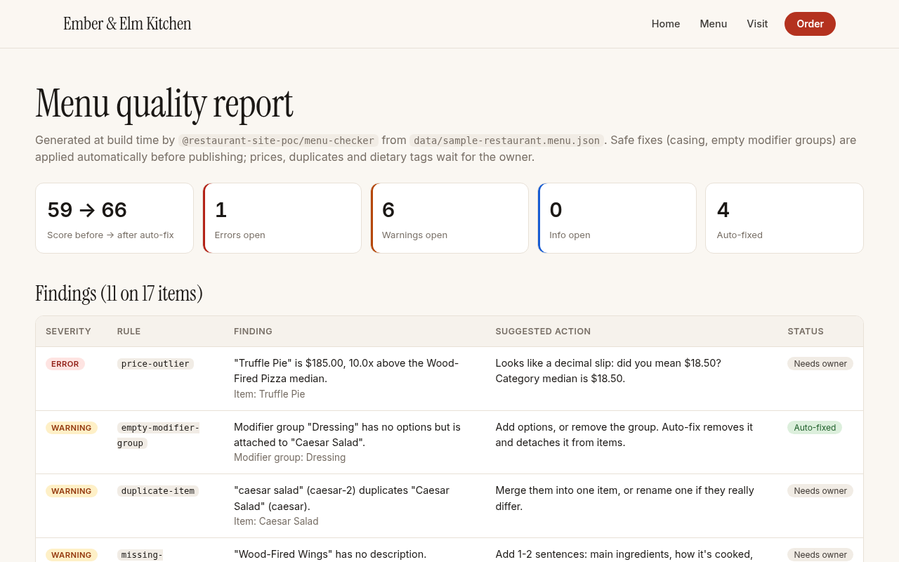
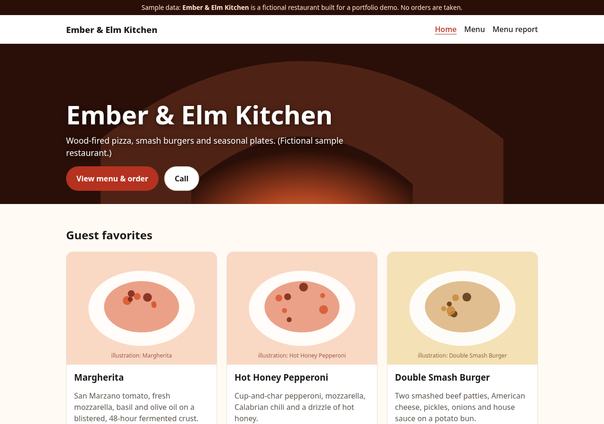
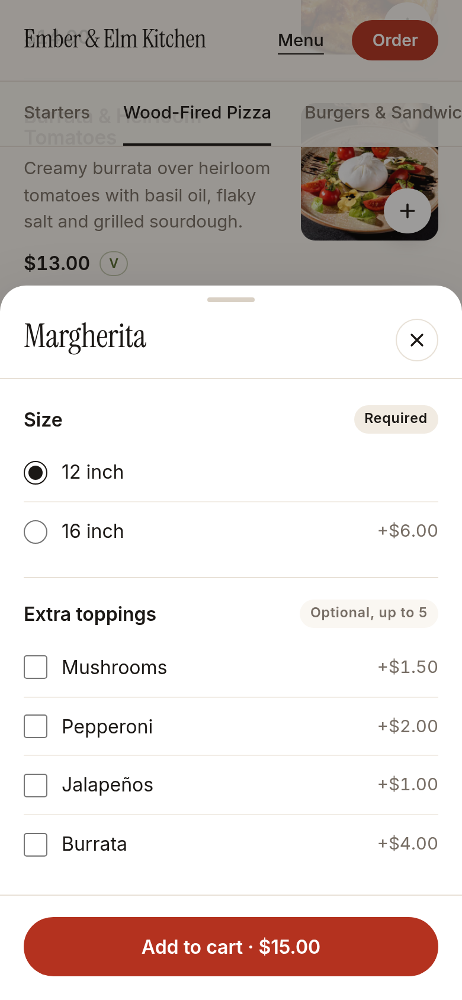
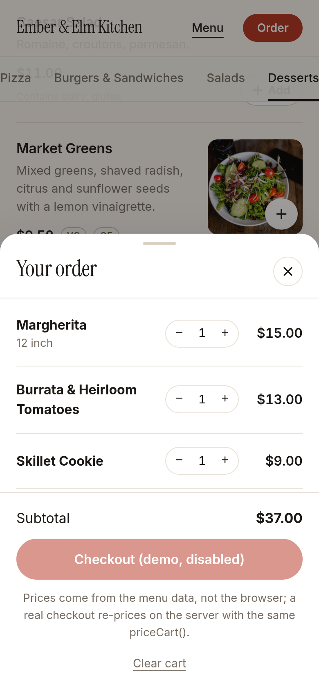

# Architecture: schema and site generator



| Home | Modifier picker (React island) | Cart |
|---|---|---|
|  |  |  |

## Layout

```
packages/
  menu-schema/    zod schema + types: restaurant, categories, items, modifier groups/options,
                  prices (integer cents), photos, dietary/allergen tags; priceCart()
  menu-checker/   rules, report + score, safe auto-fix, optional LLM pass, `check-menu` CLI
  command-engine/ editor commands (zod), deterministic parser + fuzzy matcher, LLM fallback,
                  compile → reversible ops, undo
apps/
  site/           Astro static site: / (home), /menu (menu + cart island), /admin/report
  api/            MongoDB service + framework-free router: drafts, pending changes, approve/reject,
                  undo, publish, credits, demo sandboxes; runs under Express locally
  admin/          Next.js App Router editor: live preview, push-to-talk, diff, history, credits;
                  serves the API from a route handler (Vercel); /published, /dev (margin)
data/
  sample-restaurant.menu.json   fictional sample menu (with seeded problems)
  menu-report.llm.json          saved report from one real LLM run (see menu-checker.md)
  photos/                       self-hosted Pexels photos (+ sources.json); see CREDITS.md
docs/
  token-costs.json              measured parser vs. LLM token usage (see editor.md)
scripts/          Lighthouse runner, screenshots, editor photo thumbnails, token measurement, demo recorder
```

## Menu schema (`@restaurant-site-poc/menu-schema`)

- Zod schema for the whole menu. Money is **integer cents** everywhere; float prices fail validation.
- Modifier groups live at the menu level and items reference them by id, so "Size" or "Add-ons" can be shared. Cross-references are validated (`superRefine`): unknown group ids and duplicate item ids are rejected.
- `priceCart(menu, lines)` prices a cart from ids and quantities only. It enforces min/max selections per group and rejects unknown items, options and bad quantities, so a tampered client payload can't change a total. It lives in a zod-free module (`menu-schema/pricing`) so the browser bundle stays small.

## Site generator (`apps/site`)

- **Design**: a full-bleed photo hero, Instrument Serif for display type with Inter for text (both self-hosted, latin subset, preloaded), a warm restrained palette, a classic menu list (serif dish names, dotted leaders to menu-style prices, dietary notes in plain words like "Vegetarian · Contains dairy & gluten") with one feature photo per section that alternates sides on desktop and sits above the list on phones, a sticky order button (a bottom bar on mobile) and a modifier sheet that slides up from the bottom on phones. Photos go through Astro's `<Picture>`: AVIF and WebP at several widths with `srcset`/`sizes`, explicit dimensions, lazy below the fold and `fetchpriority="high"` on the hero. Because photos are per section rather than per dish, dishes without a photo or description leave no holes. The editor's preview renders the same design.
- **Home**: hero, featured items, hours, address. **Menu**: sections with sticky category nav, prices, plain-word dietary and allergen notes, "Add" buttons. **Admin report**: the checker's findings (marked `noindex`).
- **One React island** (`Cart.tsx`, `client:idle`). The menu itself is plain HTML; the island attaches one delegated click listener for `[data-add-item]` buttons, opens a modifier picker for items with modifier groups, keeps the cart in `localStorage`, and prices it with the same `priceCart()`.
- **SEO**: per-page title/description, canonical URL, Open Graph tags, `robots.txt`, and **JSON-LD**: `Restaurant` (address, hours, cuisine) on every page, with a full `Menu` → `MenuSection` → `MenuItem` → `Offer` tree (plus `suitableForDiet`) on `/menu`. JSON-LD is escaped so menu text can't break out of the script tag.
- **Build-time publish pipeline**: validate with zod → run deterministic checks → apply safe auto-fixes → render. So "GARLIC KNOTS" ships as "Garlic Knots", but the $185.00 Truffle Pie stays on the page and gets flagged for the owner, because changing a price automatically isn't safe.
