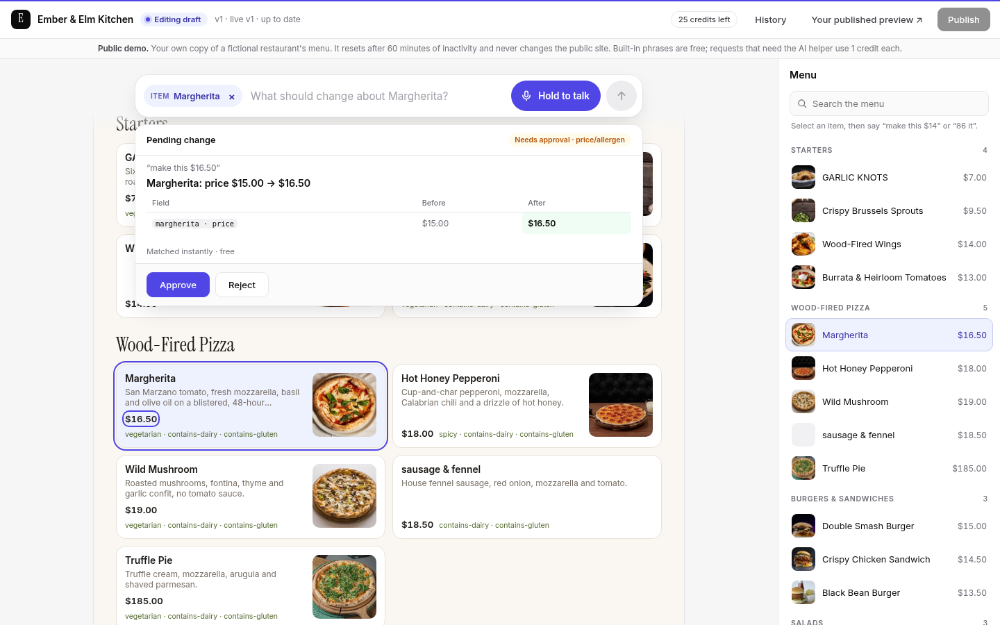
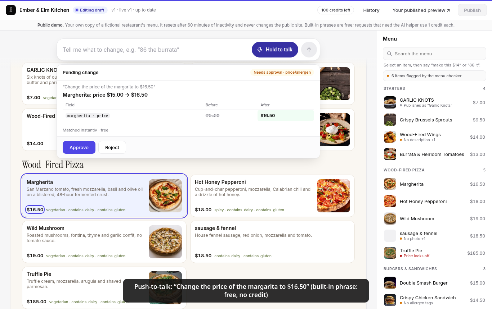
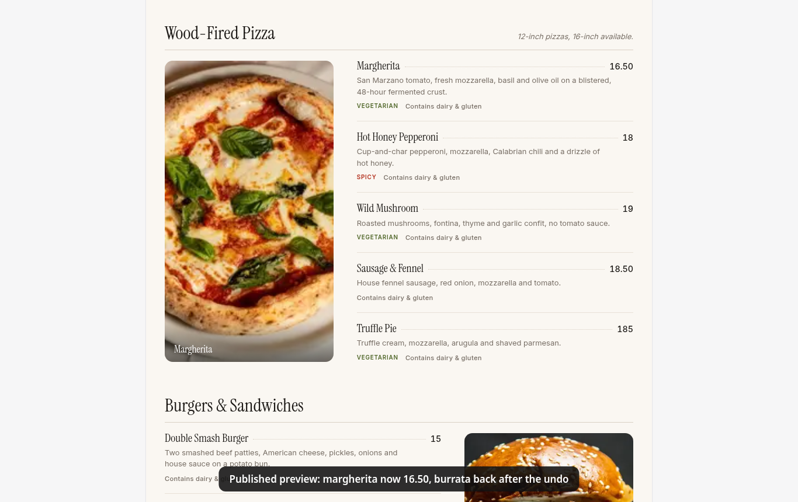
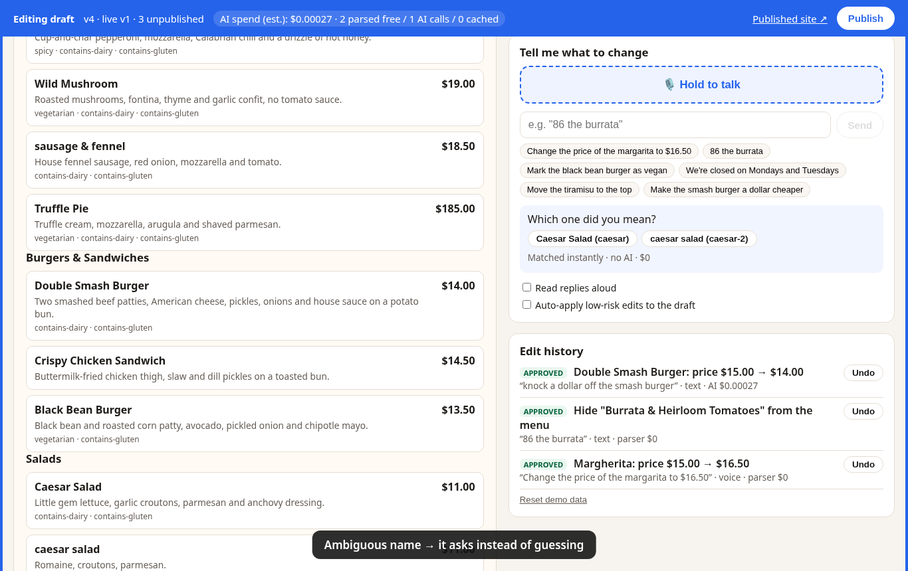
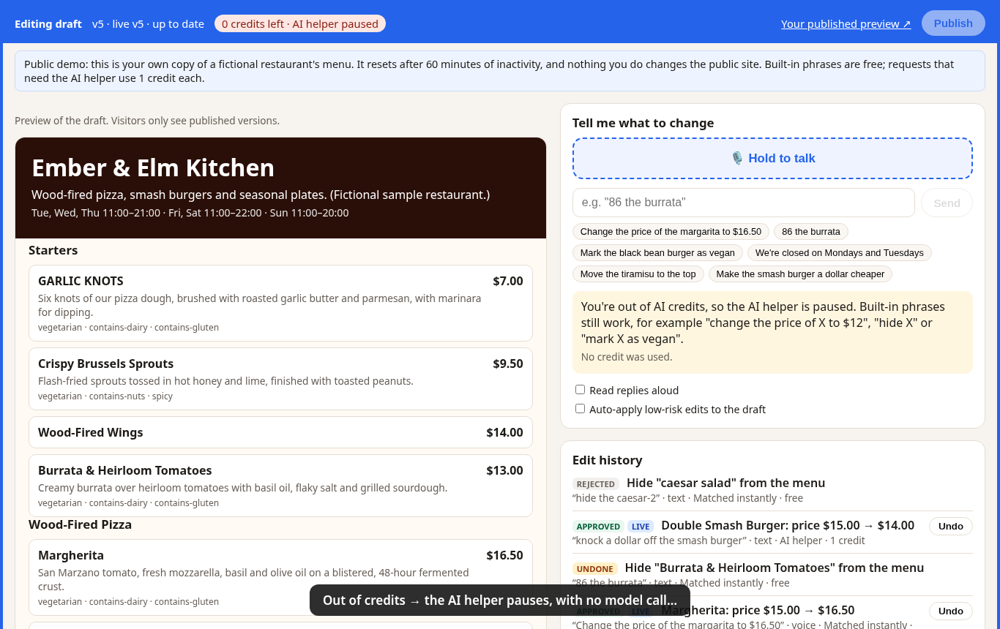
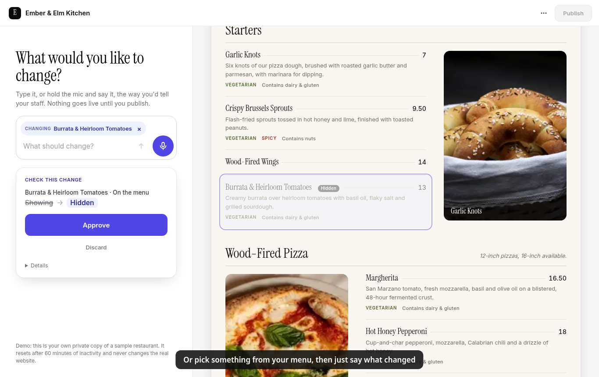
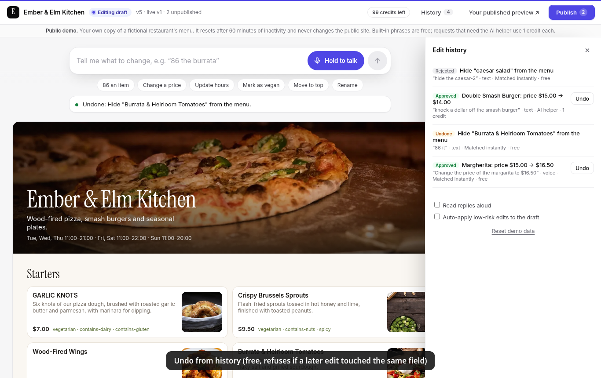
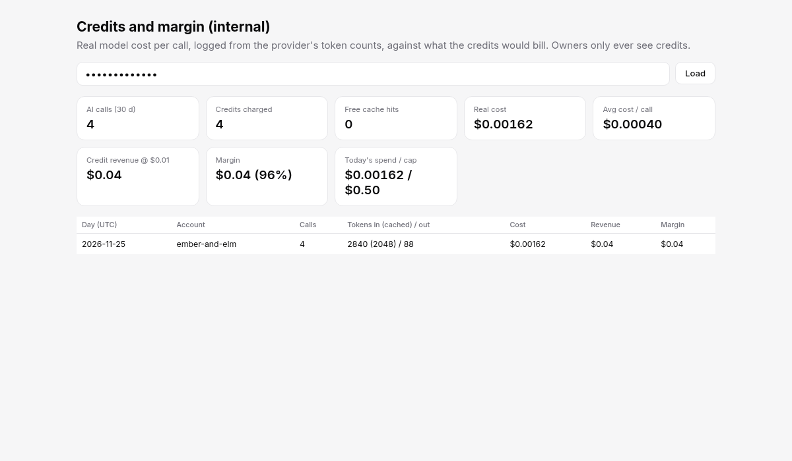
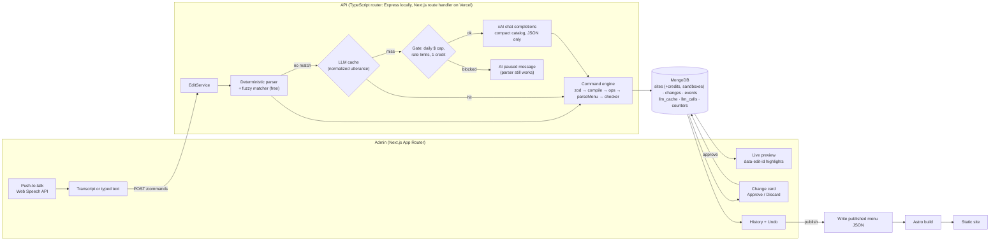

# Voice site editor, credits and the public demo

## Voice site editor (`packages/command-engine`, `apps/api`, `apps/admin`)

| Pending price change (needs approval) | Published to the visitor's private preview |
|---|---|
|  |  |
| **Ambiguous name: it asks instead of guessing** | **Out of credits: AI paused, parser still works** |
|  |  |
| **Pick an item from the menu, then say "86 it"** | **Recent changes with undo** |
|  |  |
| **Internal margin view (`/dev`)** | |
|  | |

The editor is designed for a restaurant owner on a phone between rushes, so it does one thing at a time. It asks one question, "What would you like to change?", above a big text box with a hold-to-talk mic and three plain-language ideas ("We're out of the burrata", "The margherita is now $16.50", "We're closed on Sundays"). The ideas are all handled by the built-in phrases, so they never cost an AI credit. Next to the box (below it on a phone) is the live preview of the site. A change appears as a short "Check this change" card: what changes, the old value crossed out, the new value, one big Approve and a quiet Discard. The technical diff, menu-check effects and cost sit behind "Details", and the preview scrolls to the highlighted spot. Publish is the one button top right: indigo with a count when there's something to publish, greyed out with a reason when there isn't. Everything else is one tap away but out of sight. "Or pick something from your menu" opens a searchable menu sheet; picking an item (or tapping it in the preview) makes it the target, so "make it $14" or "we're out of this" work, and the checker's findings show there as quiet notes. The ⋯ menu holds publish status, recent changes with undo, settings, the published preview link, credits and the demo reset. Nothing reaches the public site until the owner approves the change and publishes.

**The command vocabulary is fixed.** Speech never turns into HTML, CSS or free-form JSON patches. Whatever the parser or the model produces must be one of these commands, validated with zod, with targets that are real item, category or section ids:

| Command | Example utterance | Risk |
|---|---|---|
| `set_price` / `adjust_price` | "Change the price of the margarita to $16.50", "knock a dollar off the smash burger" | **always needs approval** |
| `add_dietary_tag` / `remove_dietary_tag` | "Mark the black bean burger as vegan", "the wings contain nuts" | **always needs approval** |
| `rename_item`, `set_description` | "Rename the garlic knots to Garlic Knots" | low |
| `hide_item` / `show_item` | "86 the burrata", "bring back the burrata" | low |
| `toggle_category` | "hide the desserts section" | low |
| `set_hours` | "We're closed on Mondays and Tuesdays" | low |
| `reorder` | "Move the tiramisu to the top", "put pizzas before starters" | low |
| `set_hero_text` | "change the tagline to …" | low |
| meta: `undo`, `approve`, `reject`, `publish` | "looks good", "undo that", "publish" | no model call |

How it fits together:

- **Click-to-target is deterministic.** The selected item or section is sent with the command. The parser resolves "this", "it" and "that one" to it, and accepts bare commands such as "$14", "86", "sold out", "rename to …" or "move to the top" only when something is selected; a named item still wins ("86 the burrata"). Only if the parser can't handle the request does the model see the selection, as one line of context.
- **Parser first, model second.** A deterministic parser (regex rules + a Levenshtein/word-overlap fuzzy matcher over item and section names) handles the common phrasings for free and in microseconds. Only when it can't parse a request does the API call the LLM.
- **The model expresses intent; code does the math.** "Knock a dollar off" becomes `adjust_price {deltaCents: -100}` and the engine computes the new price. (An early version asked the model for an absolute price, and it guessed wrong, because the catalog it sees doesn't include prices.)
- **Clarify or refuse instead of guessing.** Two items called "Caesar Salad" → "Which one did you mean?" with one-tap options. A request outside the vocabulary ("add a banner about our holiday party") is refused with a reason rather than squeezed into the nearest command.
- **Every change is a reversible op list.** `compile()` turns a batch of commands into `{path, before, after}` ops on semantic paths (`/items/margherita/price`), applies them atomically, re-validates the whole menu with the zod schema, and runs the menu checker to show findings the change adds or resolves. Undo reverts the ops, and refuses if a later edit changed the same field.
- **Owner-approved by design.** A proposal is a *pending change*; approval writes the draft with an optimistic-concurrency check on `draftVersion`. Prices and allergen/dietary tags always need explicit approval; there's an opt-in setting to auto-apply low-risk edits to the draft (never to the live site). Publish is refused while anything is pending.
- **Publish → static site.** Publishing copies the draft to the published version, writes the menu JSON, and re-runs the Astro build against it (about 1 s for this menu). The site pages carry `data-edit-id` attributes (`item:margherita.price`) that the admin preview uses for highlighting.
- **Voice is the browser's.** Push-to-talk uses the Web Speech API (free, no audio leaves the browser for our servers), and replies can be read aloud with `speechSynthesis`. Paid speech-to-text didn't add enough for short commands to justify the cost; the text box works everywhere the mic doesn't.

### Token budget (measured)

The model is only a fallback, and its calls are kept small: a compact catalog (`id=Name` pairs, no descriptions or prices), one-line command signatures, JSON-only output, `temperature: 0`, `max_tokens: 220`, and a MongoDB cache keyed by a hash of model + catalog + normalized utterance (30-day TTL). Every model call is logged server-side with its token counts and dollar cost; owners only ever see credits (below).

`npm run measure:tokens` runs a corpus of 21 realistic requests twice. Measured on Nov 24, 2026 against xAI `grok-4.20-0309-non-reasoning` at list prices ($1.25 / 1M input, $0.20 / 1M cached input, $2.50 / 1M output); raw data in [`docs/token-costs.json`](token-costs.json):

| Pass | Requests | Parser ($0) | Model calls | Cache hits | Input tokens (cached) | Output tokens | Cost |
|---|---|---|---|---|---|---|---|
| Cold cache | 21 | 15 | 6 | 0 | 4,264 (1,280) | 142 | **$0.0043** |
| Warm cache | 21 | 15 | 0 | 6 | 0 | 0 | **$0** |

- About 710 input and 12–45 output tokens per model call, roughly **$0.0007 per call**, at 0.5–0.7 s. When the provider's prompt cache hits most of the system prompt (640 of 710 tokens), a call costs about $0.0003.
- That works out to roughly 1,400 off-grammar commands per dollar before the utterance cache. Undo, approve, reject and publish never call the model.
- All six model results in the corpus were correct: four edits, one correctly skipped ("the market greens are gluten free and vegan": already tagged), and one refusal (the banner request).

## Credits and the public demo

**Credits.** Each restaurant (and, in demo mode, each visitor's sandbox) has a credit balance in MongoDB, `CREDITS_DEFAULT` to start (100 by default; the live demo gives each visitor 25). Built-in phrases the parser understands are free, and so are AI answers reused from the cache. A request that needs a real model call costs 1 credit. The top bar shows "N credits left", never dollars. At 0 the AI fallback pauses with a friendly message ("You're out of AI credits… built-in phrases still work") and no model call is made; parser commands keep working. Credits are taken atomically (`$gte: 1` + `$inc: -1`) before the call and refunded if the call fails. Resetting the demo restores the menu but not the credits.

**Margin, internally.** Each real call is logged with its input, cached and output tokens and its dollar cost at list price. `GET /api/admin/margin` (with `x-admin-token`) and the `/dev` page compare that with what the credits would bill at `CREDIT_PRICE_USD` ($0.01 by default), per UTC day and per restaurant. The screenshot above is real: the one AI call on the live demo that day (from an earlier recording) cost $0.00081 (710 prompt tokens, 128 of them cached by the provider, 22 output), against $0.01 of credits.

**Public demo safeguards (`DEMO_MODE=1`):**

- **A sandbox per visitor.** An HttpOnly session cookie maps each visitor to a private copy of the menu. Every request bumps its `expiresAt`, and a MongoDB TTL index deletes it after `SANDBOX_IDLE_MINUTES` (60) of inactivity. Change ids are checked against the sandbox, so one visitor can't approve another's change.
- **Rate limits on model calls** per session and per IP (hashed), in hourly windows stored in a TTL'd `counters` collection (defaults 20 and 60 per hour).
- **A global daily xAI spend cap** (`LLM_DAILY_CAP_USD`, default $0.50), metered from the provider's reported token usage. Once it's hit, the AI fallback is off for everyone until the next UTC day.
- **Publish goes to a private preview.** A visitor's publish never touches the public site. On serverless there's no per-request Astro build, so `/published` renders the sandbox's published menu with the same data, the same safe auto-fixes and the admin's React preview components. It's an honest stand-in for the static page, not the Astro output itself.

All of this is covered by tests against a real MongoDB (`apps/api/test/credits-demo.test.ts`): credit charging and refunds, pausing at 0, cache hits free, margin math, sandbox isolation and expiry, preview-only publish, per-session and per-IP limits, and the daily cap rolling over at UTC midnight.

**One API, two hosts.** Routes, validation, sessions and demo rules live in a framework-free router (`apps/api/src/router.ts`). Express adapts to it locally; on Vercel a single Next.js catch-all route handler (`apps/admin/app/api/[...path]/route.ts`) does, reusing a warm MongoDB connection pool between invocations. Set `API_URL` and the admin proxies to Express instead. Deploy steps: [docs/deploy.md](deploy.md).
